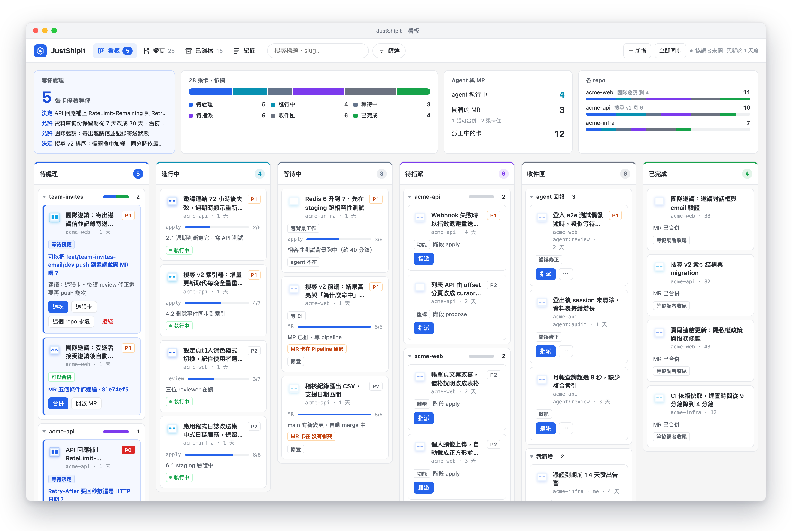
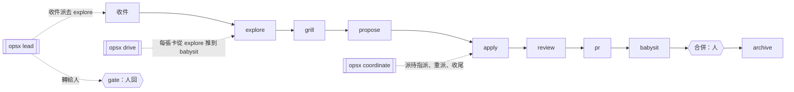
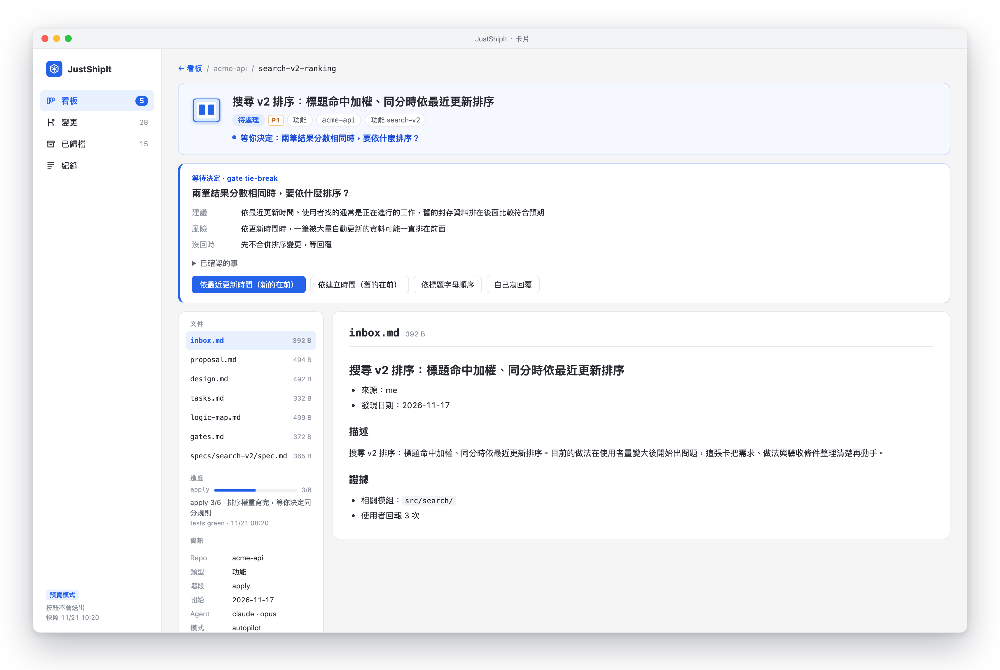
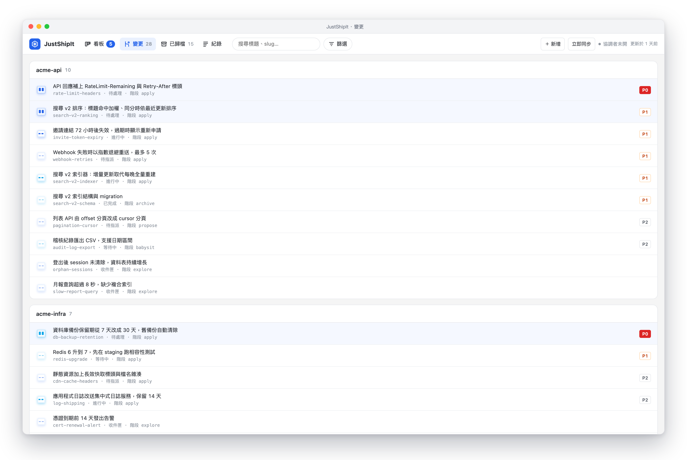
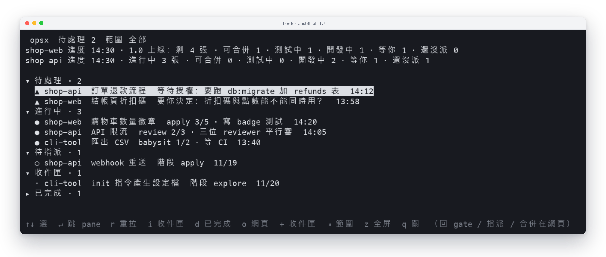

<p align="center">
  <picture>
    <source media="(prefers-color-scheme: dark)" srcset="docs/assets/brand/justshipit-logo-dark.svg" />
    
  </picture>
</p>

<p align="center"><b>A Claude Code plugin that takes each change from an inbox card to a reviewed pull request, tracks every card on one board, and leaves the merge to you.</b></p>

<p align="center"><strong>Early preview</strong> · 只在 macOS 驗證過 · 1.0 尚未完成</p>

<p align="center"><a href="LICENSE"></a></p>

跟一般 agent workflow 不一樣的地方：

- **合併永遠是人按的。** agent 把 PR 推到可合併就停，合併核准只有你寫得進去。
- **先 spec、再測試、再 review，才開 PR。** 每個改動都有 spec 與先寫的測試，review 過了才送出，一般的卡由三位 reviewer 平行審。
- **多個 agent 共用一個看板，只在需要你時才問。** 要授權或要你選的事寫成 gate，其餘時間不打擾你。
- **每支 PR 附一張邏輯表。** 從 diff 畫出功能清單、流程與條件，讓你判斷 AI 寫的邏輯，而不是只看它說了什麼。



## <a id="why"></a>解決什麼問題

同時讓好幾個 Claude Code agent 做事，難的是記得每件事做到哪、哪個 agent 在等你。JustShipIt 把「先想清楚、先寫測試、不碰 main」寫進固定流程，所有卡放在同一個看板，需要你時才找你，合併永遠由你決定。

## <a id="how"></a>怎麼運作

一個想法先變成一張收件卡，之後依序經過 explore、grill、propose、apply、review、pr、babysit，每一站是一個 skill，產出的文件都留在 `openspec/changes/<卡>/`。agent 在 worktree 裡做，測試沒綠、review 沒過就不會往下走；需要你授權或做選擇時，它寫一筆 gate 然後先做別的。



三個角色在背景推進：

- `opsx drive`：`opsx dispatch <卡> --mode autopilot` 開 worktree 與 herdr pane 後在背景啟動，每輪看卡的狀態送下一站，從 explore 推到 babysit。卡上有開著的 gate 時它等你回；MR 開了之後，開著、不是 draft、沒衝突、CI 綠、沒有未解的 review 五項都綠就停。
- `opsx coordinate`：launchd 每 5 分鐘跑一輪，收尾已合併的卡、通知等你回的 gate、重派 pane 死掉的卡，並派依賴都已合併的 P0、P1 卡。它不送站，也不合併。
- `opsx lead`：協調者 session。卡停下來要人處理時會收到通知，把每個 gate 連同建議轉給你，不替你回；列出可合併的卡與不會互相衝突的合併順序，合併後停掉 pane 並歸檔。

你要做的只有兩件事：

- **回 gate。** push、開 MR、安裝套件這類要授權的事，或要你選的事，都會變成一筆 gate。在看板回，或跑 `opsx answer <卡> --gate <id> <文字>`。
- **合併永遠留給人。** 在看板按「合併」或跑 `opsx merge <卡>`，只寫一次性核准，由 agent 執行那一次合併，agent 自己合不了。合併前可以看邏輯表，判斷這支 PR 實際做了什麼。

## <a id="features"></a>功能

- **固定流程**：每一站一個 skill，每一站留下文件，事後查得到每個決定的來源。
- **先寫測試**：apply 每條 task 先寫測試、看它紅，再寫 code；review 在測試沒綠時拒絕開始。
- **三位 reviewer**：spec 對照、程式品質、對抗式審查平行跑，範圍內的問題退回 apply，範圍外的開成新卡。
- **邏輯表**：從 diff 畫出功能清單、流程圖與條件表，只看 code，不看說明。
- **大卡自動拆**：太大的卡拆成 session、主 change、子 change，確認一次後照 workplan 做，見 [references/work-split.md](references/work-split.md)。
- **授權閘門**：沒給過授權的動作一律寫成 gate，agent 不在終端機乾等。

### 看板

看板的資料全由 `opsx collect` 從卡的檔案、狀態目錄、herdr 與 MR 狀態算出來，自己不存狀態。

- 總覽先看等你處理的卡、各階段分布、agent 與 MR、各 repo 進度。
- 欄內的卡依功能分組，可收合；一個篩選按鈕加 chips 過濾。
- 你離開期間有變動的卡，回來時用 banner 列出。
- 卡片細節頁直接讀卡目錄的文件，gate 在頁面上按選項就能回；另有變更頁與已歸檔頁。
- 已合併的卡可以按封存，背後跑 `openspec archive`。
- herdr 右側 pane 是同一份清單的終端機版本。

<table>
  <tr>
    <td width="50%"><br /><sub>卡片細節頁：gate 直接按選項回，旁邊讀卡目錄的文件</sub></td>
    <td width="50%"><br /><sub>變更頁：每個 openspec change 依 repo 分組</sub></td>
  </tr>
  <tr>
    <td width="50%"><br /><sub>網頁看板：總覽、離開期間 banner、欄內依功能分組</sub></td>
    <td width="50%"><br /><sub>herdr 右側 pane：▲ 是等你回的 gate，● 是 agent 正在做的卡，Enter 跳到那張卡的 pane</sub></td>
  </tr>
</table>

<sub>截圖中的專案與卡片都是虛構的示範資料。</sub>

## <a id="install"></a>安裝

需要：

- Claude Code 2.1.275 以上，並在設定開啟沙盒（安全模型靠它）
- Python 3.11 以上
- openspec CLI：`npm i -g @fission-ai/openspec`
- `gh` 或 `glab`，用來開 PR 與 MR
- herdr，看板與派工用

```
/plugin install opsx-workflow --marketplace Mikaelaaaaa/JustShipIt
```

裝完在終端機跑一次全域初始化，再到每個要用的 repo 根目錄初始化：

```
bash <plugin root>/bin/opsx init --global
opsx init
```

之後用 `opsx new -- "一句話說你要做什麼"` 開一張收件卡，在看板按派工，或在 Claude Code 裡跑 `/opsx-workflow:explore <卡>`。

| 平台 | 支援程度 |
|------|---------|
| macOS | 全部。`opsx init --global` 用 launchd 裝每日 `opsx sync` 與每 5 分鐘的 `opsx coordinate` |
| Linux | skills 與 `opsx` CLI 可用；沒有 `launchctl`，`opsx sync` 與 `opsx coordinate` 要自己排程 |
| Windows | 沒測過。`opsx` 是 bash 腳本 |

使用者層設定、沙盒與授權檔、herdr socket、新電腦 onboarding 見 [docs/setup.md](docs/setup.md)。

## <a id="commands"></a>常用指令

| 指令 | 做什麼 |
|------|--------|
| `opsx init --global` | 裝一次：CLI、狀態目錄、看板 plugin、全域設定 |
| `opsx init` | 在目前 repo 裝 openspec 與 opsx schema |
| `opsx new -- <一句話>` | 開一張收件卡 |
| `opsx dispatch <卡>` | 派給 agent：開 worktree、pane，送出第一句 |
| `opsx answer <卡> --gate <id> <文字>` | 回 agent 留下的 gate |
| `opsx merge <卡>` | 核准合併（一次性，沙盒外執行） |
| `opsx stop <卡>` | 停下派出去的卡 |
| `opsx sync` | 把指派給你的 issue 與程式碼裡的 `shortcut:` 註解撈進收件匣 |
| `opsx lead` | 開協調者 session，回報全部卡的進度 |

完整清單：`opsx --help`。

## <a id="security"></a>安全模型

- 開啟 Claude Code 沙盒後，agent 只能寫目前 repo、worktree 與 opsx 狀態目錄。JustShipIt 不替你開沙盒。
- push、開 MR、遷移資料庫這類動作，授權閘門先看你給過什麼授權；沒給就寫成 gate。
- 合併核准存在沙盒內寫不到的位置，只有你在沙盒外（終端機或看板）寫得進去。
- herdr socket 只有協調者 session 連得到，一般 agent 的 herdr 動作走受限的佇列。

細節與尚未驗證的地方見 [docs/setup.md](docs/setup.md)。

## <a id="docs"></a>文件

| 文件 | 內容 |
|------|------|
| [docs/setup.md](docs/setup.md) | 安裝、使用者層設定、沙盒與授權檔、herdr socket、onboarding、看板與收件匣子命令 |
| [references/work-split.md](references/work-split.md) | 大卡怎麼拆成 session、主 change、子 change |
| [references/priority.md](references/priority.md) | 卡的等級 P0 / P1 / P2 怎麼算 |
| [references/grants.md](references/grants.md) | 授權三級：哪些直接做、哪些要授權、哪些只有人能做 |
| [UPSTREAM.md](UPSTREAM.md) | 從別處搬進來或蒸餾過的檔，來源與版本 |

## <a id="status"></a>狀態

- **可用**：流程的每一站、網頁看板與 herdr 右側 pane、授權閘門、背景派工與協調。
- **部分**：Linux 上沒有內建排程；Windows 沒測過。
- **規劃中**：1.0 任一台電腦裝好就能從收件跑到 PR；2.0 卡的 worktree 能在 Orca IDE 裡開，執行層從 herdr 換成 Orca。

## <a id="contributing"></a>參與開發

- 跑測試：`bash tests/run.sh [pattern]`，`pattern` 依測試檔名過濾，不給就全跑。
- 這個 repo 自己的改動也走 opsx 流程：開卡、explore、grill、propose、apply、review、pr。
- [UPSTREAM.md](UPSTREAM.md) 列出從別處搬進來或蒸餾過的檔，升上游版本時拿它逐檔 diff。

## <a id="license"></a>授權

[MIT](LICENSE)
