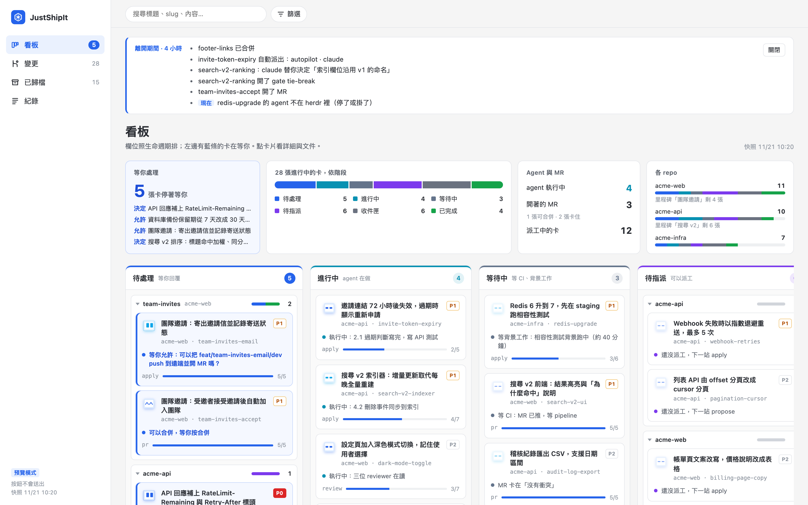
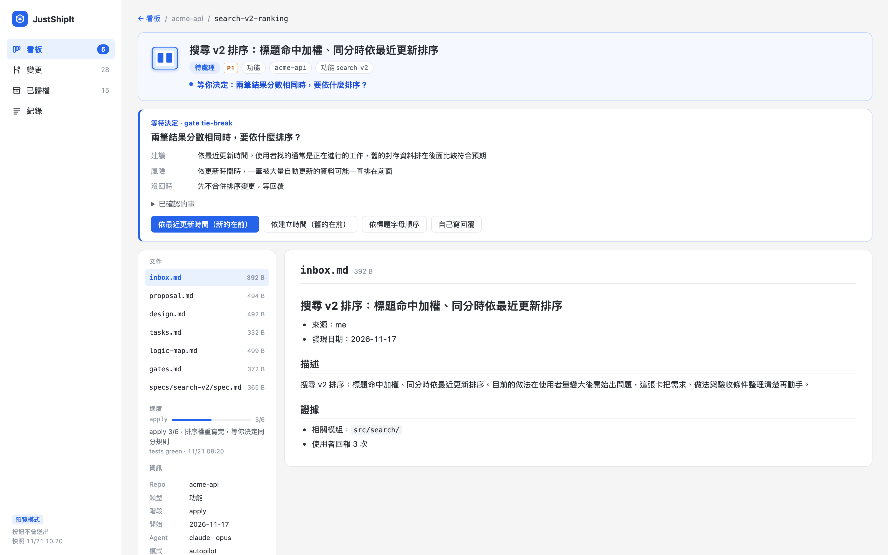
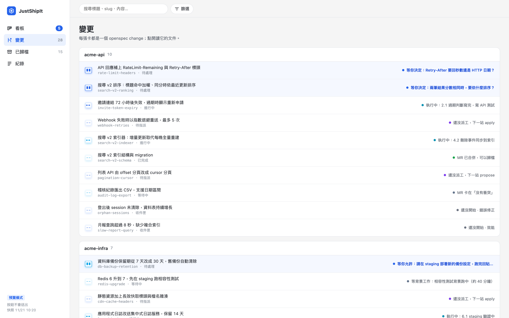
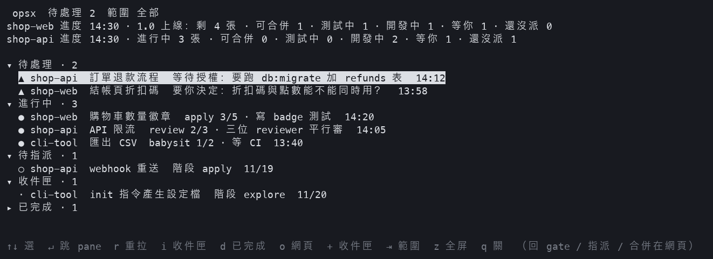
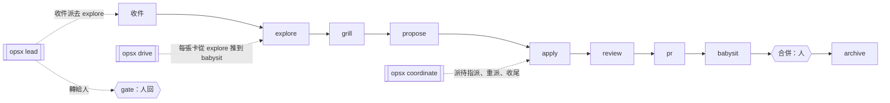

# JustShipIt

A Claude Code plugin that runs a change from inbox card to pull request, with a board to watch it, and leaves the merge to a human.


<sub>現有版本的網頁看板。新版看板的設計預覽見[示範](#demo)。</sub>

## <a id="why"></a>為什麼做

- 用 Claude Code 同時做好幾件事時，最難的不是寫 code，是記得每件事做到哪、哪個 agent 在等我回答。
- 每次都從頭跟 agent 講規矩（先想清楚、先寫測試、不要碰 main）很累。這些規矩該寫進流程，不該靠記得。
- 讓 agent 自己跑可以，但合併是最後一道人工關卡，不能讓 agent 代按。

## <a id="quick-start"></a>快速開始

需要 Claude Code 2.1.275 以上（並在 Claude Code 設定開啟沙盒，下面的安全模型靠它）、Python 3.11 以上、openspec CLI（`npm i -g @fission-ai/openspec`）、`gh` 或 `glab`（開 PR 與 MR），看板與派工另外需要 herdr。各平台能用到哪裡見[安裝](#install)。

```
/plugin install opsx-workflow --marketplace Mikaelaaaaa/JustShipIt
```

裝完在終端機跑一次全域初始化，再到每個要用的 repo 根目錄初始化：

```
bash <plugin root>/bin/opsx init --global
opsx init
```

然後 `opsx new -- "一句話說你要做什麼"` 開一張收件卡，在看板按派工，或自己在 Claude Code 裡跑 `/opsx-workflow:explore <卡>`。

設定檔改了什麼、沙盒與授權檔、herdr socket、新電腦 onboarding 都在 [docs/setup.md](docs/setup.md)。

## <a id="demo"></a>示範

<table>
  <tr>
    <td width="50%"><br /><sub>新版看板的設計預覽（實作中）：總覽、離開期間 banner、欄內依功能分組</sub></td>
    <td width="50%"><br /><sub>新版卡片細節頁的設計預覽（實作中）：gate 直接按選項回，旁邊讀卡目錄的文件</sub></td>
  </tr>
  <tr>
    <td width="50%"><br /><sub>新版變更頁的設計預覽（實作中）：每個 openspec change 依 repo 分組。三張都是虛構的示範資料（acme-web、acme-api、acme-infra）</sub></td>
    <td width="50%"><br /><sub>herdr 右側 pane（現有版本）：▲ 是等你回的 gate，● 是 agent 正在做的卡，Enter 跳到那張卡的 pane</sub></td>
  </tr>
</table>

## <a id="features"></a>功能重點

- **一條固定流程**：收件 → explore → grill → propose → apply → review → pr → babysit → archive，每一站是一個 skill，產出一份落在 `openspec/changes/<卡>/` 的文件。
- **先寫測試**：apply 每條 task 先寫測試、看它紅，再寫 code。review 在測試沒綠、task 沒測試時拒絕開始。
- **大卡自動拆**：太大的卡拆成 session、主 change、子 change，確認一次後照 workplan 自動做，見 [references/work-split.md](references/work-split.md)。
- **看板**：herdr 裡的網頁與右側 pane，顯示待處理、進行中、等待中、待指派、已完成與收件匣，按鈕背後都有對應的 `opsx` 子命令。
- **授權閘門**：agent 做到需要你決定或授權的事就寫一筆 gate 然後繼續做別的，不在終端機乾等。
- **背景派工與自動接力**：`opsx dispatch` 開 worktree 與 pane 派給 agent；`opsx coordinate` 定時收尾已合併的卡、重派死掉的卡。

## <a id="workflow"></a>流程



每一站做什麼：

- `explore` 讀 code、列出已知與待決；`grill` 一次問你一題，只問只有你能答的。
- `propose` 寫 proposal、design、spec、tasks；`apply` 照 tasks 先測試後實作，一個 change 一個 commit。
- `review` 先從 diff 畫一張邏輯表（功能清單、流程圖、條件表），再讓三位 reviewer 平行審，Bug 與 Must-fix 退回 apply；`pr` 開 MR 或 PR，並確認邏輯表對上 MR 最新的 commit；`babysit` 看 CI 與 review 留言。

誰在推：

- `opsx dispatch <卡> --mode autopilot` 開 worktree 與 herdr pane，送出第一站，並在背景起這張卡的 `opsx drive`。drive 每輪看卡的狀態送下一站，從 explore 一路推到 babysit。卡上有開著的 gate 時，它等你回，不定時催。MR 開了之後，它檢查五個條件（開著、不是 draft、沒衝突、CI 綠、沒有未解的 review），全綠就停，沒綠就跑一次 babysit 再等 CI。
- `opsx coordinate` 由 launchd 每 5 分鐘跑一輪：收尾已合併的卡、通知等人回的 gate、重派 pane 死掉的卡，派依賴都合併了的 P0、P1 待指派卡（同時活著的 pane 預設最多 8 個，P0 不受這個上限）。收件匣的卡它不派，它也不送站、不合併。
- `opsx lead` 開協調者 session。卡停住要人處理時（gate、停住、MR 卡住），Stop hook 和 coordinate 會通知它；只是在等 subagent 或 CI 的卡不會通知。它把每個 gate 連同建議轉給你，不替你回；列出可合併的卡和不會互相衝突的合併順序；卡合併後停掉 pane 並歸檔。收件匣去重後，它把 P0、P1 收件卡派去 explore，P2 收件卡只列給你看。沒有 pane 在做、也沒有 gate 等你時，它再派下一張待指派卡，P2 也派。

你要做的只有兩件事：

- **回 gate。** agent 做到要授權（push、開 MR、安裝套件）或要你選的事，就寫一筆 gate 然後先做別的。在看板回，或跑 `opsx answer <卡> --gate <id> <文字>`；lead 也會用彈窗問你，一批最多四題。
- **合併永遠留給人。** 在看板按「合併」或跑 `opsx merge <卡>`，只寫一次性核准，由 agent 執行那一次合併，agent 自己合不了。合併前看邏輯表判斷這支 PR 做了什麼。

沒有 openspec 殼的小想法也可以先 `/opsx-workflow:explore` 隨便聊，想清楚再開卡。

## <a id="board"></a>看板

本段以新版看板為準。新版還在開發，main 上目前是舊版：README 開頭的動圖是舊版，示範段的看板截圖是新版的設計預覽。

新版網頁看板：

- 藍色淺色主題，首頁先看總覽視覺化。
- 欄內的卡依功能分組，每組可收合。
- 一個篩選按鈕加 chips 過濾。
- 你離開期間有變動的卡，回來時用 banner 列出（現有版本已有，新版沿用）。
- 卡片細節頁直接讀卡目錄裡的文件；另有變更頁與已歸檔頁。
- 已合併的卡可以按封存，背後跑 `openspec archive`。

資料全是投影（`opsx collect` 從卡的檔案、狀態目錄、herdr 與 MR 狀態算出來），看板自己不存狀態。

- 網頁：herdr 裡叫 action `open-board`，或 `bash herdr-board/scripts/open-board.sh`。
- 右側 pane：herdr 裡叫 action `open-pane`，同一份清單，↑↓ 選、Enter 跳到 pane。
- 收件匣 tab：還沒派出的卡，依來源分組；`opsx sync` 每天把指派給你的 issue 與程式碼裡的 `shortcut:` 註解撈進來。

快捷鍵、收件匣子命令與每日同步見 [docs/setup.md](docs/setup.md)。

## <a id="commands"></a>常用指令

| 指令 | 做什麼 |
|------|--------|
| `opsx init --global` | 裝一次：CLI、狀態目錄、看板 plugin、全域設定 |
| `opsx init` | 在目前 repo 裝 openspec 與 opsx schema |
| `opsx new -- <一句話>` | 開一張收件卡 |
| `opsx dispatch <卡>` | 派給 agent：開 worktree、pane，送出第一句 |
| `opsx answer <卡> --gate <id> <文字>` | 回 agent 留下的 gate |
| `opsx merge <卡>` | 核准合併（一次性，沙盒外執行） |
| `opsx stop <卡>` | 停下派出去的卡 |
| `opsx sync` | 把 issue 與 `shortcut:` 註解撈進收件匣 |
| `opsx lead` | 開協調者 session，回報全部卡的進度 |

完整清單：`opsx --help`。

## <a id="security"></a>安全模型

- 開啟 Claude Code 沙盒後，agent 在沙盒內跑，只能寫目前 repo、worktree 與 opsx 狀態目錄；JustShipIt 不替你開沙盒。
- 做到 push、開 MR、遷移資料庫這類事，授權閘門先看你給過什麼授權；沒給就寫成 gate 等你回。
- 合併核准存在沙盒內寫不到的位置，只有你在沙盒外（終端機或看板）才寫得進去（同樣要先開沙盒）。
- herdr socket 只有協調者 session 連得到，一般 agent 的 herdr 動作走受限的佇列。

細節與已知沒驗證的地方見 [docs/setup.md](docs/setup.md)。

## <a id="install"></a>安裝

plugin 與 `opsx` CLI 的裝法各平台相同（見[快速開始](#quick-start)），差在 `opsx init --global` 能不能裝排程：

| 平台 | 能用到哪裡 |
|------|-----------|
| macOS | 全部。`opsx init --global` 用 launchd 裝每日 `opsx sync` 與每 5 分鐘的 `opsx coordinate` |
| Linux | skills 與 `opsx` CLI 可用。找不到 `launchctl` 時 `opsx init --global` 略過排程，要自己跑 `opsx sync` 與 `opsx coordinate` |
| Windows | 沒測過。`opsx` 是 bash 腳本 |

## <a id="docs"></a>文件

| 文件 | 內容 |
|------|------|
| [docs/setup.md](docs/setup.md) | 安裝、使用者層設定、沙盒與授權檔、herdr socket、onboarding、看板與收件匣子命令 |
| [references/work-split.md](references/work-split.md) | 大卡怎麼拆成 session、主 change、子 change |
| [references/priority.md](references/priority.md) | 卡的等級 P0 / P1 / P2 怎麼算 |
| [references/grants.md](references/grants.md) | 授權三級：哪些直接做、哪些要授權、哪些只有人能做 |
| [UPSTREAM.md](UPSTREAM.md) | 從別處搬進來或蒸餾過的檔，來源與版本 |

## <a id="status"></a>狀態

- **可用**：上面那條流程的每一站、網頁看板與 herdr 右側 pane、授權閘門、`opsx dispatch` 與 `opsx drive` 背景派工、`opsx coordinate` 與 `opsx lead` 協調。
- **部分**：Linux 上沒有排程，`opsx sync` 與 `opsx coordinate` 要手動跑；Windows 沒測過。
- **規劃中**：
  - **新版看板**：上面看板段寫的設計，開發中；示範段是它的設計預覽。
  - **1.0 全自動**：任一台電腦裝好就能用；卡從收件到 PR 自己跑完，合併留給人。
  - **2.0 Orca**：卡的 worktree 在 Orca IDE 裡開得到，驗證過後執行層從 herdr 換成 Orca。

## <a id="contributing"></a>參與開發

- 跑測試：`bash tests/run.sh [pattern]`，`pattern` 依測試檔名過濾，不給就全跑。
- 這個 repo 自己的改動也走 opsx 流程：開卡、explore、grill、propose、apply、review、pr。
- [UPSTREAM.md](UPSTREAM.md) 列出從別處搬進來或蒸餾過的檔。升上游版本時拿它逐檔 diff，沒列的檔是 JustShipIt 自己寫的。

## <a id="license"></a>授權

[MIT](LICENSE)
